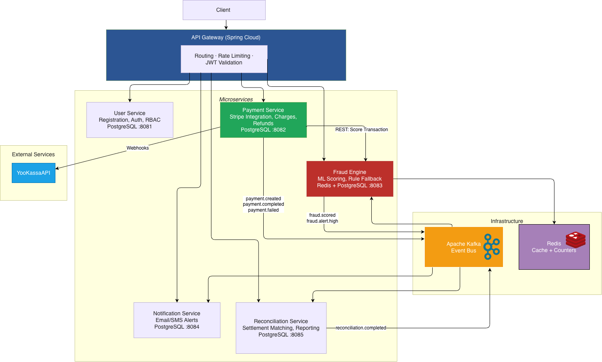

# Payment Processing Platform

Микросервисная платформа для обработки платежей с интеграцией Stripe, проверкой транзакций на мошенничество, уведомлениями и сверкой платежей.

Архитектура сочетает синхронное взаимодействие через REST API и асинхронную обработку событий через Apache Kafka.

## Технологии

| Технология | Назначение |
|------------|------------|
| Java / Spring Boot | Разработка backend-микросервисов |
| Spring Cloud Gateway | Единая точка входа, маршрутизация запросов, rate limiting и проверка JWT |
| JWT / RBAC | Аутентификация и управление доступом на основе ролей |
| PostgreSQL | Хранение данных сервисов |
| Apache Kafka | Асинхронное взаимодействие и доставка доменных событий |
| Redis | Кеширование и хранение счетчиков |
| Stripe API | Проведение платежей и возвратов |
| REST API | Синхронное взаимодействие между компонентами |
| Webhooks | Получение уведомлений от Stripe |
| Rule-based Scoring | Оценка риска транзакций |

## Архитектура

Клиент обращается к системе через API Gateway, который маршрутизирует запросы к соответствующим микросервисам.

Основные компоненты:

- User Service — пользователи, аутентификация и роли.
- Payment Service — платежи, возвраты и интеграция со Stripe.
- Fraud Engine — оценка риска транзакций.
- Notification Service — email- и SMS-уведомления.
- Reconciliation Service — сверка расчетов и отчетность.

Apache Kafka используется как шина событий. Redis предоставляет кеш и счетчики для Fraud Engine. PostgreSQL используется для хранения данных микросервисов.

## Микросервисы

### API Gateway

Технология: Spring Cloud Gateway.

Отвечает за:

- Единую точку входа для клиентских запросов.
- Маршрутизацию к микросервисам.
- Ограничение частоты запросов.
- Валидацию JWT.

### User Service

Порт: `8081`  
Хранилище: PostgreSQL.

Отвечает за:

- Регистрацию пользователей.
- Аутентификацию.
- Управление ролями и правами доступа — RBAC.

### Payment Service

Порт: `8082`  
Хранилище: PostgreSQL.  
Интеграция: Stripe API.

Отвечает за:

- Создание и обработку платежей.
- Выполнение возвратов.
- Взаимодействие со Stripe API.
- Обработку webhook-уведомлений от Stripe.
- Запрос оценки риска у Fraud Engine через REST API.
- Публикацию событий о состоянии платежей в Kafka.

События:

- `payment.created`
- `payment.completed`
- `payment.failed`

### Fraud Engine

Порт: `8083`  
Хранилища: PostgreSQL и Redis.

Отвечает за:

- Оценку риска транзакций с использованием ML-модели.
- Резервную проверку по правилам — rule-based fallback.
- Использование кеша и счетчиков Redis.
- Обработку событий из Kafka и публикацию результатов проверки.

Взаимодействие:

- REST API — синхронная оценка транзакции по запросу Payment Service.
- Kafka — асинхронный обмен событиями.

События:

- `fraud.scored`
- `fraud.alert.high`

### Notification Service

Порт: `8084`  
Хранилище: PostgreSQL.

Отвечает за:

- Отправку email- и SMS-уведомлений.
- Обработку событий из Kafka.
- Уведомление пользователей о результатах обработки платежей и предупреждениях.

Сервис доступен через API Gateway и получает события через Kafka.

### Reconciliation Service

Порт: `8085`  
Хранилище: PostgreSQL.

Отвечает за:

- Сверку платежей и расчетов — settlement matching.
- Формирование отчетности.
- Обработку событий из Kafka.
- Публикацию события о завершении сверки.

Событие:

- `reconciliation.completed`

## Основной сценарий обработки платежа

1. Клиент отправляет запрос через API Gateway.
2. Gateway проверяет JWT, применяет ограничения частоты запросов и направляет запрос в Payment Service.
3. Payment Service запрашивает оценку риска у Fraud Engine через REST API.
4. Fraud Engine выполняет проверку с использованием ML-модели или резервных правил.
5. Payment Service взаимодействует со Stripe для выполнения платежной операции.
6. Stripe отправляет webhook-уведомления об изменении состояния платежа.
7. Payment Service публикует события о состоянии платежа в Kafka.
8. Заинтересованные сервисы обрабатывают события: отправляют уведомления, выполняют сверку и формируют отчетность.

## Событийное взаимодействие

| Событие | Источник | Назначение |
|---------|----------|------------|
| `payment.created` | Payment Service | Создание платежа |
| `payment.completed` | Payment Service | Успешное завершение платежа |
| `payment.failed` | Payment Service | Ошибка обработки платежа |
| `fraud.scored` | Fraud Engine | Результат оценки риска транзакции |
| `fraud.alert.high` | Fraud Engine | Обнаружение высокого риска |
| `reconciliation.completed` | Reconciliation Service | Завершение сверки |

Названия выше обозначают доменные события. Их распределение по Kafka topics определяется конфигурацией приложения.

## Инфраструктура

### PostgreSQL

Хранение данных пользователей, платежей, проверок, уведомлений и результатов сверки.

### Apache Kafka

Шина событий для асинхронного взаимодействия сервисов и обработки изменений состояния платежей.

### Redis

Кеширование и хранение счетчиков, используемых при проверке транзакций Fraud Engine.

### Stripe

Внешняя платежная система для выполнения платежей и возвратов. Изменения статуса операций поступают в систему через webhooks.